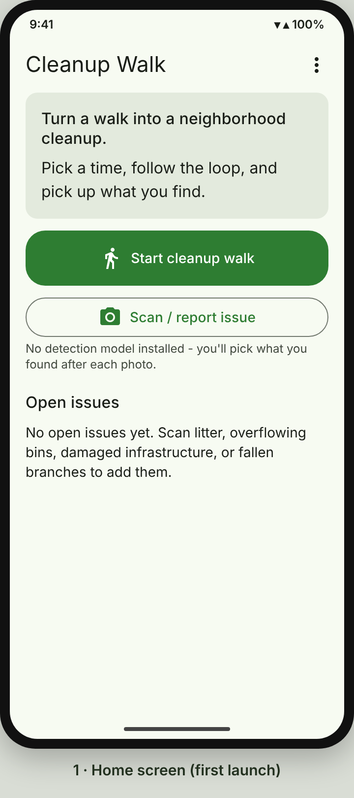
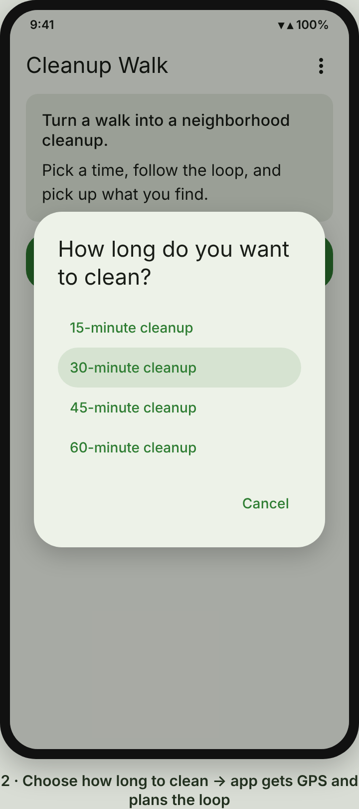
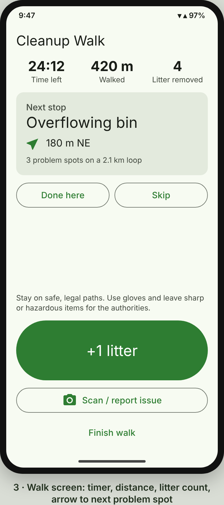
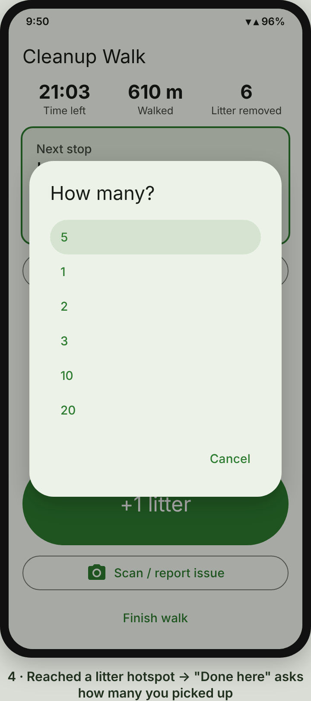
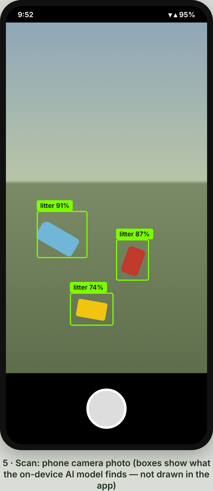
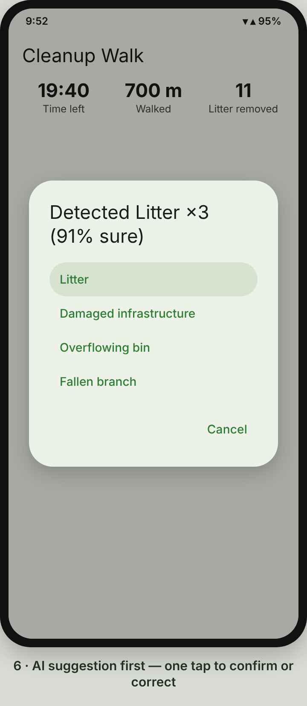
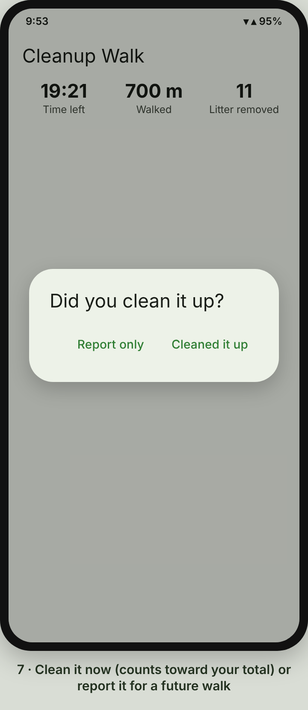
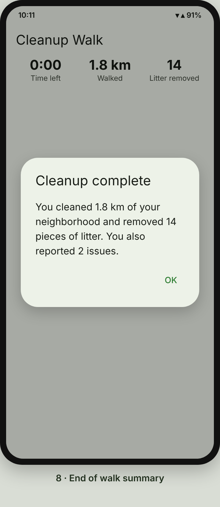
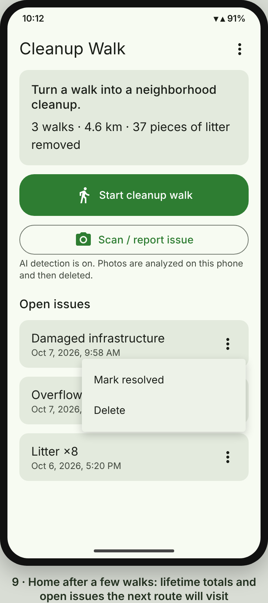

# Cleanup Walk

An Android app that turns screen time into a neighborhood cleanup.

Pick **"30-minute cleanup"**, follow a walking loop that prioritizes places with visible problems, pick up litter or report what you find, and at the end:

> You cleaned 1.8 km of your neighborhood and removed 14 pieces of litter.

The app's job isn't to entertain you — it converts screen interaction into physical action.

## Screenshots

| 1 · Home | 2 · Choose a duration | 3 · Walk in progress |
|:---:|:---:|:---:|
|  |  |  |
| Start a walk or scan an issue; open issues listed below. | 15, 30, 45 or 60 minutes. The app gets your location and plans the loop. | Time left, distance, litter count, and an arrow to the next problem spot. |

| 4 · At a problem spot | 5 · Scan | 6 · AI suggestion |
|:---:|:---:|:---:|
|  |  |  |
| "Done here" asks how many pieces you picked up. | Take a photo; the on-device model finds the litter in it. | The model's suggestion comes first — one tap to confirm or correct. |

| 7 · Clean or report | 8 · Summary | 9 · Home after a few walks |
|:---:|:---:|:---:|
|  |  |  |
| Cleaned items count toward your total; reported ones are routed on future walks. | "You cleaned 1.8 km of your neighborhood and removed 14 pieces of litter." | Lifetime totals, plus open issues you can mark resolved or delete. |

## What it does

- **Spots problems with the camera.** Take a photo and an on-device model detects litter, overflowing bins, damaged public infrastructure, and fallen branches, with a count. Confirm or correct with one tap. Photos never leave the phone and are deleted right after analysis.
- **Plans a time-boxed route.** Choose 15, 30, 45, or 60 minutes. The planner builds a loop from your location that visits known problem spots within that time, weighting damaged infrastructure and overflowing bins highest, then fallen branches and litter, and preferring spots with more litter and fresher reports. Spare time becomes exploration stops in a new direction so you find new problems.
- **Guides the walk.** Time left, distance walked, litter removed, plus the next stop's distance and direction. Exploration stops tick off automatically when you reach them; at problem spots you tap **Done here** (resolving the issue) or **Skip**. A big **+1 litter** button counts everything you pick up along the way.
- **Remembers.** Open issues are saved so future walks route past them. Walks survive the app being closed. Lifetime totals show on the home screen.

Everything works offline. There is no account, server, or Google Play Services dependency.

## Build

Requirements: Android Studio (Ladybug or newer) or JDK 17 + Android SDK 35.

```bash
./gradlew assembleDebug        # app/build/outputs/apk/debug/app-debug.apk
./gradlew testDebugUnitTest    # route planner, distance tracking, scan interpretation, walk manager
```

Min SDK 26 (Android 8.0).

## Detection model

The app ships without a model. Until one is added, you pick what you found after each photo — everything else works the same.

Add a model either way:

1. **No rebuild:** open the ⋮ menu → **Import detection model** and choose a `.tflite` file.
2. **Bundled:** place it at `app/src/main/assets/models/issue_detector.tflite`.

### Model contract

- Input: `[1, H, W, 3]`, `UINT8` (0–255) or `FLOAT32` (normalized to [-1, 1]).
- Outputs (any order, identified automatically): boxes `[1, N, 4]` as (top, left, bottom, right) in [0, 1], classes `[1, N]`, scores `[1, N]`, count `[1]`.
- Class order: `0` litter, `1` overflowing bin, `2` damaged infrastructure, `3` fallen branch.

This is the standard post-processed SSD format exported by MediaPipe Model Maker's object detector, the TensorFlow Object Detection API, and EfficientDet-Lite.

### Training one

1. Collect labeled photos. The TACO dataset (Trash Annotations in Context) covers litter; add your own photos of bins, damaged infrastructure (broken benches, signs, fences, potholes), and fallen branches. Label all four classes in COCO format using the class order above.
2. Train with MediaPipe Model Maker (`mediapipe_model_maker.object_detector`) using `EFFICIENTDET_LITE0` or `MOBILENET_MULTI_AVG`, and export with int8 quantization.
3. Import or bundle the `.tflite` file as above. Keep it under ~10 MB.

Inference uses LiteRT (formerly TensorFlow Lite) on the CPU.

## How the route planner works

Choosing which spots to visit within a time limit is an *orienteering problem*. The planner (`domain/CleanupRoutePlanner.kt`):

1. Scores each open issue: `priority × (1 + ln(count)) × freshness`, where freshness halves every 14 days (floor 0.25).
2. Keeps issues reachable and returnable within the budget at 1.25 m/s, with straight-line distances × 1.3 to allow for streets.
3. Greedily inserts the issue with the best score-per-extra-second at its cheapest position in the loop, improving the loop with 2-opt after each insertion, until nothing else fits.
4. If more than 15% of the time is left, adds an octagonal exploration loop sized to the remaining time, heading away from the visited issues, and inserts its points the same way.

The estimated time never exceeds the time you chose (covered by a randomized test).

Directions are straight-line distance and compass direction, not turn-by-turn. Stay on safe, legal paths.

## Project layout

```
app/src/main/java/app/cleanupwalk/
├── domain/       Pure Kotlin: route planner, distance tracker, scan interpretation, walk progress
├── data/         Room database (issues, walks) and repository
├── detection/    LiteRT detector, model import, photo capture + analysis
├── location/     GPS via the platform LocationManager
├── walk/         WalkManager - the active walk's state and persistence
└── ui/           Jetpack Compose screens (home, walk, scan flow)

docs/screenshots/ README screenshots
```

## Privacy

- Photos are analyzed on the device and deleted immediately.
- Locations of issues and walk totals are stored only in the app's private database.
- Nothing is uploaded anywhere.
